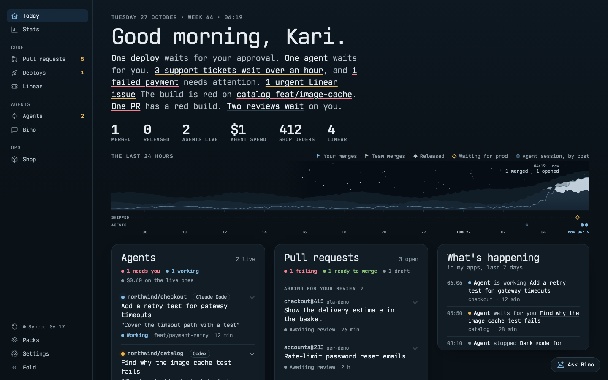

# Dovre

**A self-hosted cockpit for your repos, CI and coding agents.** Runs on your machine, your own server, or Cloudflare Workers.

[](LICENSE) · **[Try the demo](https://demo.dovre.dev)** · [dovre.dev](https://dovre.dev) · [Docs](https://dovre.dev/docs)

[](https://demo.dovre.dev)

- **One morning view.** Pull requests, red builds, deploys waiting for approval and what changed in your apps, across every repo on `github.com` or GitHub Enterprise.
- **Your coding agents in one place.** `claude`, `codex`, `omp`, `copilot` and `agy` sessions: who is working, who needs you, what they cost.
- **Packs for the rest.** Linear, Slack, OpenTelemetry, Kafka, DuckDB and more each add a card, a page and answers to Bino, the built-in assistant.

## Run it locally

Needs Node 24+, pnpm (`corepack enable`), and `gh auth login` (or sign in on `/setup`).

```sh
git clone https://github.com/bergaaberg/dovre.git && cd dovre
pnpm install
pnpm dev        # http://127.0.0.1:4848
```

`/setup` finds your GitHub user and orgs and writes `.dev.vars`. On Windows, `pwsh scripts/install.ps1` (needs Go) also installs the `dovre` launcher, a Ctrl+Alt+D hotkey and start at login.

## Run it hosted

On Cloudflare Workers, D1 and Durable Objects, behind Cloudflare Access. Your laptop dials out to it (`pnpm bridge`) to run agents, with no open ports:

```sh
pnpm instance new ../my-dovre --domain dovre.example.com
pnpm instance provision ../my-dovre --deploy
pnpm bridge
```

On dovre.dev, pair a machine with the `dovre` launcher instead: `dovre bridge login <handle>`, then `dovre bridge install` to start it at login (`status`, `uninstall`, `logout` too).

Your own server instead: [docs/SELF-HOST.md](docs/SELF-HOST.md). Reaching a local Dovre from another machine: [docs/REMOTE.md](docs/REMOTE.md). What Dovre sends to its own services, and how to check: [docs/SENT.md](docs/SENT.md).

## Packs

Each app Dovre works with is a pack. Six ship with core, each switched off with `PACK_<ID>=off`:

| Pack | What it does |
|---|---|
| `agents` | Agent sessions, live turns, worktrees, tool approvals |
| `assistant` | Bino and its [memlet](https://github.com/bergaaberg/memlet) memory |
| `terminal` | Web terminals in your checkouts (local) |
| `tracker` | Your open issues on `/tracker` |
| `storybook` | A PR's stories before and after (local) |

More in [`bergaaberg/dovre-packs`](https://github.com/bergaaberg/dovre-packs). A pack is copied into your instance repo, so you can edit it:

```sh
pnpm packs list
pnpm packs add cf-health --into ../my-dovre   # its newest release (or --to x.y.z)
pnpm packs new my-app --into ../my-dovre
pnpm packs outdated --into ../my-dovre        # each copy's version, the newest release, what changed
pnpm packs update cf-health --into ../my-dovre # to the newest release; merges your edits
```

Each pack in dovre-packs has its own version and changelog, released as a tag `<id>@x.y.z`. No checkout of dovre-packs? The CLI keeps its own clone in `~/.cache/dovre/dovre-packs`. On a machine, the Packs page lists the packs you don't have yet, each with **Add** (copied into the instance, checked, rolled back if the checks fail; then restart). Hosted, the Packs page says when a newer release is out and what changed; take it with `pnpm packs update` in the instance repo, then deploy. With `INSTANCE_REPO` set, hosted **Add** opens a PR on the instance repo instead; merge it and deploy.

A pack's secret setting (an API key) can be where the key lives instead of the key: `op://vault/item/field` (1Password), `https://<vault>.vault.azure.net/secrets/<name>`, an AWS Secrets Manager ARN or `aws://<name>`, `projects/<p>/secrets/<name>` (GCP), `bw://<secret id>` (Bitwarden Secrets Manager) or `keychain://<service>/<account>`. `.dev.vars` keeps the reference. Dovre reads the key with that store's CLI (`op`, `az`, `aws`, `gcloud`, `bws`, `security`) when it starts, again when the pack's refresh fails, and on **Read the keys again** in the pack's Settings, and keeps it in memory only. A key pasted on Settings goes to the macOS Keychain (`keychain://dovre/<KEY>`). A key that can't be read leaves its pack off, with why. Hosted, the Worker reads a reference over the store's own API when it starts (and on **Read the keys again**), given that store's credential as Worker secrets: `AZURE_TENANT_ID`, `AZURE_CLIENT_ID` and `AZURE_CLIENT_SECRET` (Azure Key Vault), `GCP_SERVICE_ACCOUNT` (a service account's JSON key), `AWS_ACCESS_KEY_ID` and `AWS_SECRET_ACCESS_KEY` (plus `AWS_REGION` for `aws://`), or `OP_CONNECT_HOST` and `OP_CONNECT_TOKEN` (a [1Password Connect](https://developer.1password.com/docs/connect/) server). The key stays in the isolate's memory, never in D1. Bitwarden and Keychain references are read on a machine only.

A pack can also replace GitHub as the forge (`FORGE=<its id>`). How packs work: [docs/ARCHITECTURE.md](docs/ARCHITECTURE.md).

One pack on its own, in a throw-away session (prototype, [#353](https://github.com/bergaaberg/dovre/issues/353)):

```sh
dovre run http ../my-repo   # the pack's pages only, on a random port; Ctrl+C and it's gone
dovre run topo ../my-repo --set TOPO_MAP=rings   # a non-secret setting, for this session
```

`dovre run` starts `src/run.ts` of the core checkout the launcher was built in, on the launcher's pinned Node (downloaded once, as for the bridge), and passes the arguments through; `node src/run.ts …` in the checkout does the same.

The session has its own launch token and an in-memory database, and serves nothing of the cockpit. The pack sees only the checkout it was started on (packs on API 1.7 and up). The pack's settings (only the keys its manifest names) come, first found wins, from `--set KEY=value` (never a secret one: the command line lands in shell history), the shell's environment, then the local instance's `.dev.vars`, which is read, never written. The menu's Settings page sets the rest for this session only, in memory; a pack missing a required setting starts on that page and turns on once it's given. A pack with tools also prints a `claude mcp add` line: a Claude Code session gets that one pack's tools on the session's `/mcp`, with a token made for the session (never the launch token), good until it ends.

## Topo

Put a [`peak.yaml`](https://github.com/bergaaberg/peak) at the root of a checkout to say what the repo is, how much care it gets, who owns which files and what to read first. The `topo` pack (local) shows it on `/topo`, gives it to Bino and agents, and shows the tier on pull requests. Add it with `pnpm packs add topo`.

## Code and diffs (local)

`/code` browses any checkout under `CODE_DIR` at any ref. `/code/<checkout>/diff` shows uncommitted changes, a branch against a ref, or one commit. `/compare` diffs two pasted texts or JSON documents.

## Report a bug

**Report a bug** in the menu (`g r`, or search "bug") opens `/bug` with the page you came from. Error pages and Bino link there too, with what went wrong filled in. The report goes to the repo behind the page: Dovre's own, dovre-packs, or `INSTANCE_REPO` for an instance's own pack. **Open on GitHub** prefills a new issue under your login. **File it** has the token create it, labelled `bug`, but only in the owners' repos.

## More

- [docs/CONFIG.md](docs/CONFIG.md): every setting
- [docs/ARCHITECTURE.md](docs/ARCHITECTURE.md): core, packs, the Pack contract
- [PLAN.md](PLAN.md): locked decisions · [docs/LEXICON.md](docs/LEXICON.md): words we use

```sh
pnpm dev       # local server, watch mode
pnpm check     # typecheck, tests, Go launcher tests
```

MIT. See [LICENSE](LICENSE).
