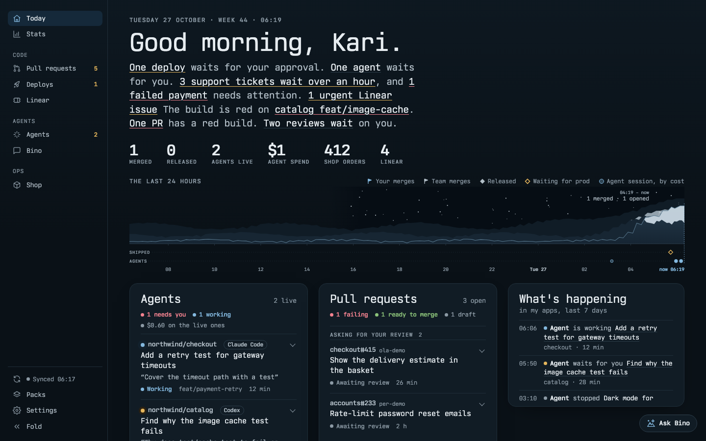

# Dovre

**A self-hosted cockpit for your repos, CI and coding agents.** Runs on Cloudflare Workers or your own server.

[](LICENSE) · **[Try the demo](https://demo.dovre.dev)** · [dovre.dev](https://dovre.dev) · [Docs](https://dovre.dev/docs)

[](https://demo.dovre.dev)

- **One morning view.** Pull requests, red builds, deploys waiting for approval and what changed in your apps, across every repo on `github.com` or GitHub Enterprise, in one live page.
- **Your coding agents in one place.** `claude`, `codex`, `omp`, `copilot` and `agy` sessions: who is working, who needs you, and what they cost, from your desk or your phone.
- **Packs for the rest.** Linear, Slack, OpenTelemetry, Kafka, DuckDB, Docker and more each add a card, a page and answers to Bino, the built-in assistant.

More:

- **Pre-Built Packs:** [`bergaaberg/dovre-packs`](https://github.com/bergaaberg/dovre-packs)
- **Scoped Assistant Memory:** [`bergaaberg/memlet`](https://github.com/bergaaberg/memlet)
- **Self-host on Cloudflare or your own server:** [docs/SELF-HOST.md](docs/SELF-HOST.md) · **Reach local Dovre from another machine:** [docs/REMOTE.md](docs/REMOTE.md)
- **Architecture & Pack API:** [docs/ARCHITECTURE.md](docs/ARCHITECTURE.md) · [docs/LEXICON.md](docs/LEXICON.md) · [PLAN.md](PLAN.md)

---

## Quick Start (Local)

Requires **Node 24+** and **pnpm** (`corepack enable`). Sign in with **GitHub CLI** (`gh auth login`), or start Dovre and complete the one-click interactive browser sign-in on `/setup`.

### macOS & Linux

```sh
git clone https://github.com/bergaaberg/dovre.git && cd dovre
pnpm install
pnpm dev                         # opens http://127.0.0.1:4848
```

### Windows

```powershell
git clone https://github.com/bergaaberg/dovre; cd dovre
pnpm install
pwsh scripts/install.ps1         # optional (requires Go): builds native supervisor, Ctrl+Alt+D, login start
pnpm dev                         # or `dovre` if launcher is installed
```

On first start, `/setup` auto-discovers your authenticated GitHub user and organisations (`REPO_OWNERS`) and writes `.dev.vars` (`0600`).

---

## Hosted on Cloudflare Workers + Mac Bridge

Run Dovre at the edge on **Cloudflare Workers + D1 + Durable Objects** behind **Cloudflare Access** (`IS_HOSTED=1`), while your workstation dials outbound (`pnpm bridge`) to run local coding agents with zero inbound ports:

```sh
# 1. Scaffold a separate instance repo beside dovre
pnpm instance new ../my-dovre --domain dovre.example.com

# 2. Auto-provision D1, apply migrations, generate BRIDGE_KEY, and push Worker secrets
pnpm instance provision ../my-dovre --deploy

# 3. Start the outbound Mac Bridge (or install at login via scripts/install-bridge.sh)
pnpm bridge
```

### The bridge for hosted Dovre (`dovre bridge`)

On dovre.dev, a machine is paired instead of configured. The `dovre` launcher pairs it, runs it on a pinned Node (downloaded once and checked by sha256), and starts it at login on macOS (launchd), Linux (a systemd user unit) or Windows (the Run key):

```sh
dovre bridge login <handle>   # type the code it prints at <handle>.dovre.dev/cloud/bridge
dovre bridge install          # start at login, and now
dovre bridge status           # paired with what, running, the log's last lines
dovre bridge uninstall        # stop, and don't start at login
dovre bridge logout           # unpair this machine: stop, revoke its sign-in, forget it
```

Its sign-in, data, Node and log live in the user config folder (`~/Library/Application Support/dovre`, `~/.config/dovre`, `%AppData%\dovre`; `DOVRE_BRIDGE_HOME` moves them). The bridge's code is a bundle beside the binary (`bridge/main.mjs`, built with `pnpm build:bridge`); in a checkout it falls back to `dist/bridge` or `src/bridge/main.ts`.

---

## Pluggable Packs (`PACK_API = 1`)

Dovre Core ships five built-in packs under `src/packs/core/`:

| Core Pack | Purpose | Toggle |
|---|---|---|
| `agents` | Multi-harness session discovery, live streaming turns, worktrees, and tool approval bar (`claude`, `codex`, `omp`, `copilot`, `agy`) | `PACK_AGENTS=off` / `AGENT_HARNESSES` |
| `assistant` | **Bino** assistant + **Repo Atlas** (`range.yaml` catalog) + [`memlet`](https://github.com/bergaaberg/memlet) scoped SQLite/D1 memory | `PACK_ASSISTANT=off` / `PACK_ATLAS=off` |
| `terminal` | Strict-origin local PTY web terminals (`/terminal`) | `PACK_TERMINAL=off` |
| `docker` | Container and compose project controls + live SSE logs (`/docker`) | `PACK_DOCKER=off` |

A pack can also bring a **forge** (`forge` hook, `src/forge/types.ts`) so that PRs/MRs, CI, notifications and deploys come from somewhere other than GitHub. Set `FORGE=<its id>` to use it. There's one forge per instance, and GitHub is the default.

### Add a Pre-Built or Custom Pack

Install pre-built packs from [`bergaaberg/dovre-packs`](https://github.com/bergaaberg/dovre-packs) (`cf-health`, `http-otel`, `docker`, `jira`, `custom-app`) or scaffold a new one:

```sh
pnpm packs list
pnpm packs add cf-health --into ../my-dovre
pnpm packs new my-app --into ../my-dovre
```

See [docs/ARCHITECTURE.md](docs/ARCHITECTURE.md) for the full `Pack` contract (`src/packs/types.ts`), hooks (`today`, `routes`, `slots`, `needs`, `bino`, `acts`, `dock`, `scheduled`, `email`), and isolation guarantees.

---

## Repo Atlas (`range.yaml`)

Drop a `range.yaml` manifest into any checkout under `CODE_DIR` to catalog components, file ownership boundaries, and rules in `/atlas` and `/agents/new`:

```yaml
name: Quill
description: Publishing platform and worker queue
url: https://quill.example
tier: active
components:
  - name: web
    owns: [src/web/, src/ui/]
    rules: .claude/rules/web.md
docs:
  plan: docs/PLAN.md
  architecture: ARCHITECTURE.md
health:
  workers: [quill-web, quill-dispatcher]
```

---

## Configuration (`.dev.vars` or Settings Page)

| Key | Purpose | Default |
|---|---|---|
| `FORGE` | Where the code lives: `github`, or the id of a forge a pack brings (`Pack.forge`, e.g. `gitlab`). Pages that forge can't serve are hidden | `github` |
| `REPO_HOST` | GitHub host (`github.com` or GitHub Enterprise hostname) | `github.com` |
| `REPO_OWNERS` | Comma-separated GitHub orgs/users to track | auto-discovered on `/setup` |
| `GITHUB_TOKEN` / `GHE_TOKEN` | GitHub token (uses `gh auth token` locally when unset). Hosted, an instance can pass `createWorker({ githubToken: async (bindings) => … })` instead, for a rotating token such as a GitHub App's; it's asked before every call and wins over the secret | `gh auth token` |
| `PUBLIC_ORIGIN` | Local mode behind a sign-in proxy: the one public address it serves Dovre at, exactly `https://host[:port]` ([docs/SELF-HOST.md](docs/SELF-HOST.md)). Environment or `.dev.vars` only | unset (localhost only) |
| `LISTEN_HOST` | Address the server listens on. Only for a container whose port is published to the host's loopback | `127.0.0.1` |
| `CODE_DIR` | Parent directory of local repo checkouts | `~/Code` or `~/src` |
| `AGENT_HARNESSES` | Enabled local agent CLIs (`claude,codex,omp,copilot,agy`) | all detected on `PATH` |
| `ASSISTANT_VIA` (`BINO_VIA`) | Assistant route: `api-key`, `cf-gateway`, `openrouter`, `claude`, `codex`, `omp`, `copilot`, `agy`, or `off` | best detected harness |
| `ASSISTANT_API_KEY` | Provider API key when `ASSISTANT_VIA=api-key` (`claude-haiku-5-5`, `gpt-4o-mini`, or `gemini-2.5-flash`) | optional |
| `OPENROUTER_API_KEY` | OpenRouter key when `ASSISTANT_VIA=openrouter` | optional |
| `CF_ACCOUNT_ID`, `CF_AIG_TOKEN` | Cloudflare AI Gateway account & token (`ASSISTANT_VIA=cf-gateway`) | optional |
| `PACKS` | Comma-separated instance pack directories loaded locally | none |
| `PACK_<ID>` | Set `off` to disable any core or instance pack | `on` |
| `IS_HOSTED` | `1` on Cloudflare Workers (enforces the RS256 JWT check: Cloudflare Access or `AUTH_ISSUER`) | `0` (local loopback) |
| `CF_ACCESS_TEAM`, `CF_ACCESS_AUD` | Cloudflare Zero Trust team name and application Audience (AUD) tag | required when `IS_HOSTED=1`, unless `AUTH_ISSUER` is set |
| `AUTH_ISSUER`, `AUTH_AUD`, `AUTH_JWKS_URL` | Instead of Access: any issuer that signs RS256 JWTs (sent in `Cf-Access-Jwt-Assertion`). Its exact `iss` (https), the expected `aud`, and its keys. When set, it wins; a bad value lets nobody in | JWKS: `<issuer>/.well-known/jwks.json` |
| `BRIDGE_URL`, `BRIDGE_KEY` | Outbound bridge WebSocket URL (`wss://<host>/bridge`) and the root HMAC secret. Without `BRIDGE_KEY`, `/bridge` is closed | optional |
| `BRIDGE_CLIENT_ID` | The Access service token the one machine `mac` signs in with (it signs frames with `BRIDGE_KEY` itself). Machines an issuer names in a JWT's `service` claim (16–32 hex) need no setting: each signs with its own key, `HMAC(BRIDGE_KEY, "dovre-bridge/1\|machine\|<id>")`, and several can be online at once | optional |
| `CRON_KEY` | Hosts without cron triggers: `POST /_dovre/scheduled` with `Authorization: Bearer <CRON_KEY>` (32+ characters) runs the cron and answers `204`. Unset, the route is a `404` | optional |

---

## Development

```sh
pnpm dev       # Start local server on http://127.0.0.1:4848 (watch mode)
pnpm check     # Run tsc --noEmit, Node test suite, and Go launcher tests
```

## License

MIT. See [LICENSE](LICENSE).
